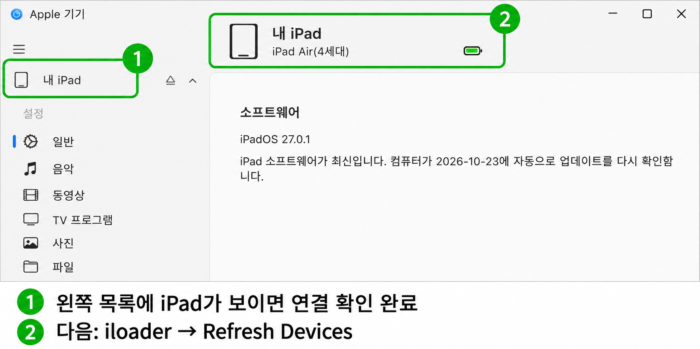
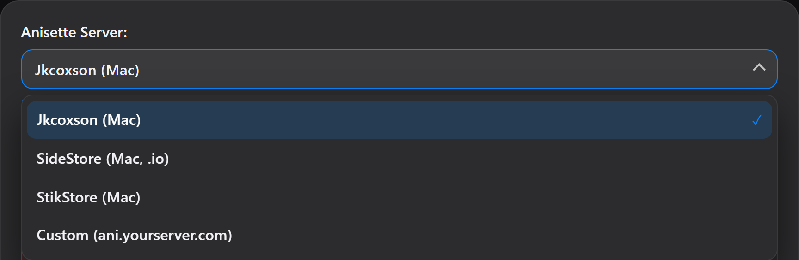
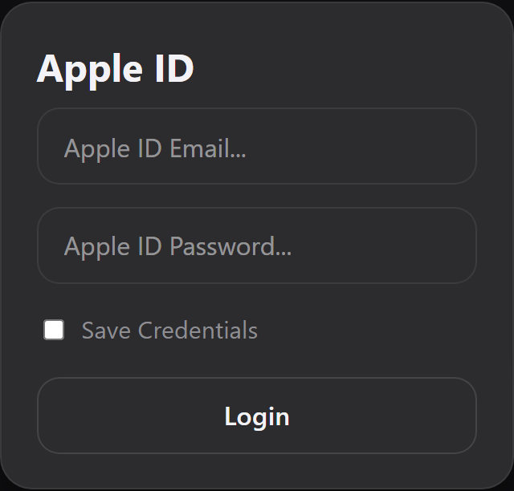
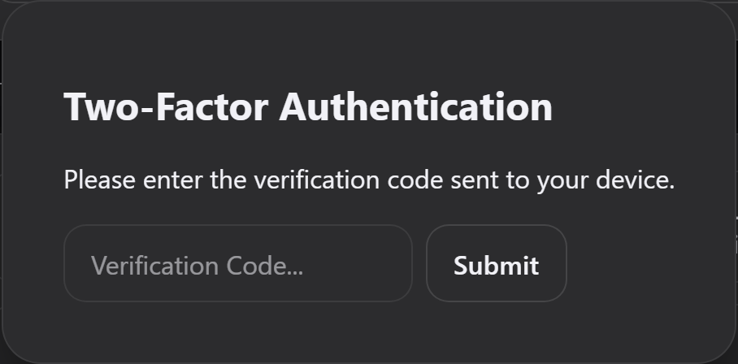
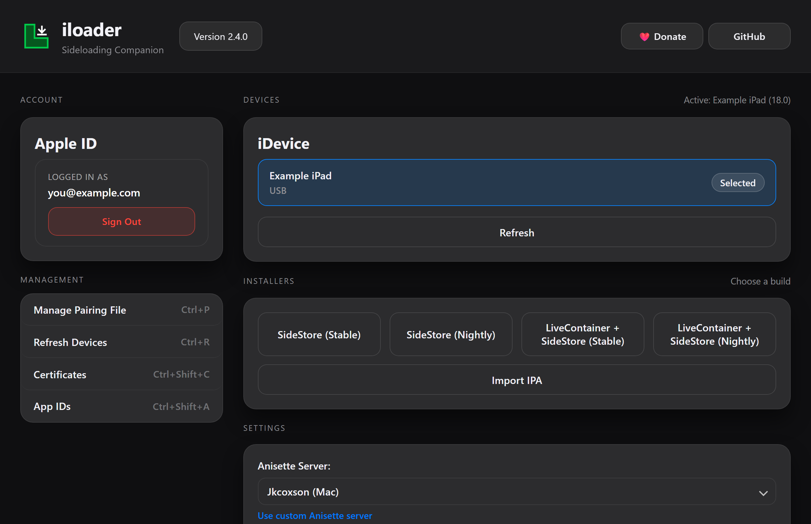
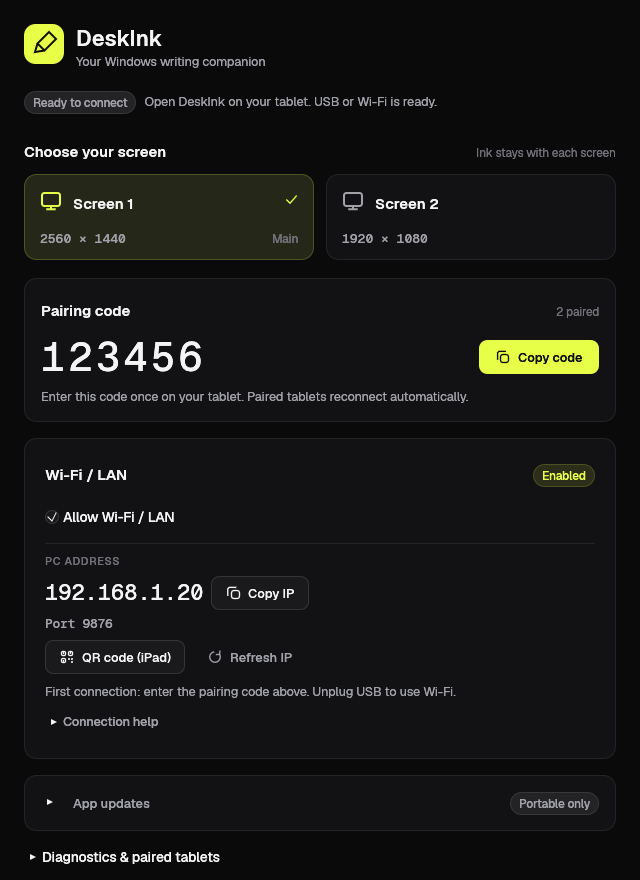
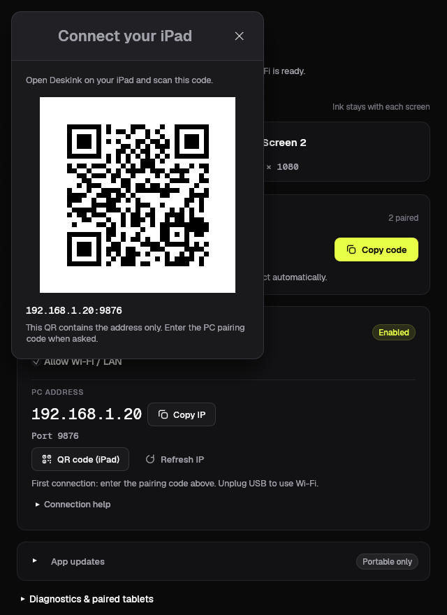
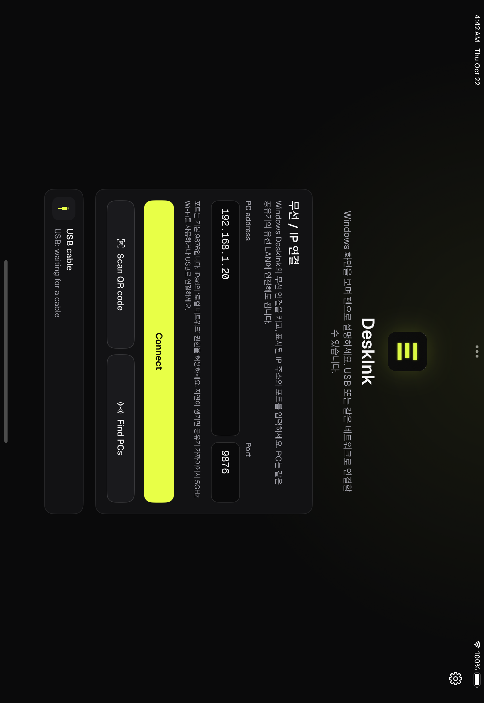
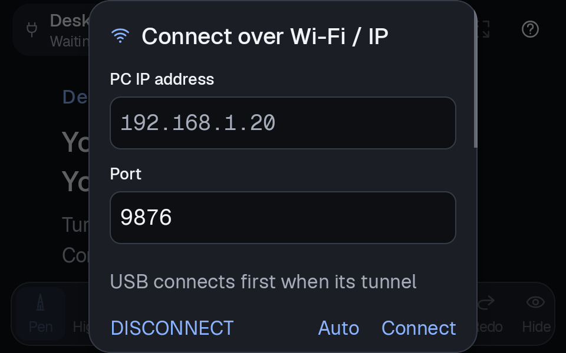
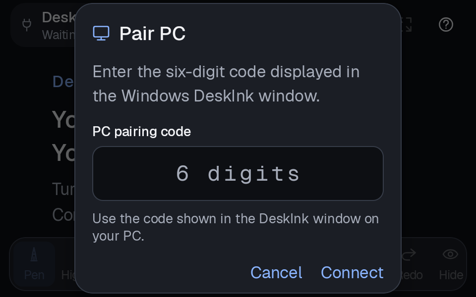

# DeskInk

**아이패드·갤럭시탭의 펜으로 Windows 화면을 칠판처럼 사용합니다.**

[English](README.md) · **한국어** · [캡처로 보는 설치·사용 안내](https://zkdlwuthwo1-hash.github.io/deskink/README.html)

USB 또는 같은 로컬 네트워크의 Wi-Fi/LAN으로 연결한 태블릿에 Windows 화면을 띄우고, 펜으로 쓰면 PC 화면 위에도 필기가 나타납니다. 태블릿에서만 확대할 수 있으며, PC 조작은 평소처럼 마우스와 키보드로 합니다.

## 주요 기능

- Windows 화면 위에 펜·형광펜으로 쓰고, 지우개·레이저·사라지는 펜으로 설명합니다.
- 도형을 그리고 펜을 떼지 않은 채 1초 멈추면 원·타원·사각형·직선으로 보정합니다.
- 올가미로 필기를 선택해 이동·크기 조절하고, 12색과 지우개 3단계를 사용합니다.
- Windows·Android 앱 안에서 새 버전을 확인하고 업데이트합니다.
- 태블릿에서만 두 손가락으로 확대·이동합니다. PC 화면의 배율은 그대로입니다.
- 바탕화면 아이콘으로 모니터를 전환하고, 실행 중에는 화면마다 필기를 따로 유지합니다.
- S펜은 버튼을 누르는 동안 지우개로 바뀌며, 지원 Apple Pencil은 두 번 탭으로 전환합니다.
- 기존 USB 연결을 쓰거나, 무선 연결을 켜고 QR(iPad)·IP 주소(iPad/Android)로 PC를 선택합니다.

## 다운로드

아래에서 설치 파일과 공식 설치 페이지를 엽니다. **Windows ZIP·iPad IPA·iloader·Apple 기기는 PC에서, Android APK는 태블릿에서** 받으세요.

| 다운로드 | 사용 방법 |
| --- | --- |
| [**Windows 앱 ZIP 다운로드**](https://github.com/zkdlwuthwo1-hash/deskink/releases/download/v0.6.0/DeskInk-Windows-x64.zip?v=0.6.0) | **가장 먼저 준비합니다.** 전체 압축을 풀고 아래의 Windows PC 준비 순서를 따르세요. |
| [**Android 앱 APK 다운로드**](https://github.com/zkdlwuthwo1-hash/deskink/releases/download/v0.6.2/DeskInk-Android.apk?v=0.6.2) | 갤럭시탭 등 Android 8 이상 태블릿에서 파일을 열고 **설치** |
| [**iPad 앱 IPA 다운로드**](https://github.com/zkdlwuthwo1-hash/deskink/releases/download/v0.6.2/DeskInk-iPad-unsigned.ipa?v=0.6.2) | PC의 iloader에서 불러와 아이패드에 설치 |
| [**iloader Windows 설치 파일 다운로드**](https://github.com/nab138/iloader/releases/latest/download/iloader-windows-x64.exe) | iPad 앱 설치용 도구. 공식 배포처의 EXE를 받아 PC에서 실행 |
| [**Apple 기기 설치 · Microsoft Store**](https://apps.microsoft.com/detail/9np83lwlpz9k?hl=ko-KR&gl=KR) | iPad 첫 USB 연결 준비·기기 인식 확인. 이미 정상 인식되는 PC는 생략 가능 |
| [**설치·사용 안내 HTML 다운로드**](https://github.com/zkdlwuthwo1-hash/deskink/releases/download/v0.6.2/README.html) | 캡처가 포함된 안내서를 브라우저에서 열기 |

**도형 보정·올가미를 사용하려면 Windows 0.6.0과 태블릿 0.6.2를 사용하세요.** PC에서는 iPad·갤럭시탭 모두 `DeskInk.exe` 하나로 시작합니다. 이전 PC에 연결하면 새 편집 도구가 비활성화되며 일반 필기는 계속 사용할 수 있습니다.

**업데이트할 때 기존 앱을 삭제하지 마세요.** PC 등록과 설정을 유지하면서 새 버전으로 바꿉니다.

- **Windows 0.5.1 이상:** 실행 시 새 버전을 확인합니다. **App updates → Download update → Install and restart (clears ink)**를 누릅니다. 기존 모니터 아이콘·페어링은 유지되고, 재시작하면 현재 필기는 지워집니다. 더 오래된 버전은 최신 ZIP의 전체 내용을 기존 폴더에 한 번 덮어쓰세요.
- **Android 0.6.0 이상:** 오른쪽 위 **업데이트(아래 화살표)** → **업데이트 받기 → 업데이트 설치**를 누릅니다. 새 버전은 앱을 열 때와 열어 둔 동안 주기적으로 확인합니다. 처음에는 **설정 열기 → 이 출처 허용** 후 DeskInk로 돌아오세요. Android 설치창에서 사용자가 확인해야 설치됩니다. **현재 0.5.1 등 이전 APK를 쓰는 분은 이번 0.6.2만 다운로드해서 기존 앱 위에 설치**하면, 다음 버전부터 앱 안에서 받을 수 있습니다.
- **iPad:** 무료 iloader 방식을 유지합니다. 새 IPA를 PC에서 받아 **같은 Apple 계정 → Import IPA**로 기존 앱 위에 설치하세요. 자동 업데이트는 지원하지 않으며, 무료 서명은 아래 안내대로 7일마다 갱신합니다.

업데이트 설치는 발표를 마친 뒤 진행하세요. 장시간 사용 중 지연과 일부 갤럭시탭의 모니터 전환 증상은 별도로 확인 중입니다.

준비물: 최신 Windows x64 PC, iPadOS 17 이상 또는 Android 8 이상 태블릿, 호환 펜. USB 연결과 iPad 설치에는 데이터 USB 케이블을, 무선 연결에는 신뢰하는 로컬 네트워크를 사용합니다. **Mac이나 개발 도구 없이 설치할 수 있습니다.** 첫 PC 설정에는 인터넷이 필요합니다. [최신 배포 안내](https://github.com/zkdlwuthwo1-hash/deskink/releases/tag/v0.6.2) · [iloader 공식 안내](https://iloader.app/)

## 먼저 Windows PC 준비하기

**iPad와 갤럭시탭 모두 Windows 앱부터 준비합니다.** 아래 단계를 마친 뒤 사용하는 태블릿의 설치 안내로 이동하세요.

1. 위의 **Windows 앱 ZIP**을 PC에서 다운로드합니다.
2. 문서 폴더 등 쓰기 가능한 위치에 **전체 압축 해제**합니다. ZIP 안에서 바로 실행하지 말고, 압축을 푼 폴더의 파일을 함께 보관하세요.
3. 그 폴더의 **`DeskInk.exe`**를 실행합니다. 첫 실행은 영상 구성요소 약 60MB를 내려받고 검사하므로 인터넷이 필요합니다. 갤럭시탭 USB 연결용 구성요소 약 8MB도 **백그라운드에서 자동으로 준비**합니다. 이후에는 준비된 파일을 재사용합니다. 갤럭시탭 USB 준비가 끝나기까지 잠시 걸릴 수 있으며, 이 준비가 실패해도 iPad·무선 연결은 사용할 수 있습니다. 갤럭시탭 USB 준비를 다시 시도하려면 인터넷 연결을 확인하고 DeskInk를 완전히 종료한 뒤 다시 실행하세요.
4. Windows DeskInk 창이 열리면 아래에서 **[아이패드](#아이패드에-처음-설치하기)** 또는 **[갤럭시탭·Android](#갤럭시탭android에-처음-설치하기)** 안내를 따릅니다. 태블릿 앱을 설치하기 전에는 연결 대기 상태여도 정상입니다.

바탕화면에 **DeskInk - Screen 1 / Screen 2** 아이콘이 자동으로 만들어집니다. 다음부터는 원하는 화면의 아이콘이나 **`DeskInk.exe`**만 실행하면 됩니다. **Windows 0.5.3부터 별도의 Android 준비·바로가기 생성 EXE를 실행할 필요가 없습니다.** ZIP의 `bin`·`scripts`·`runtime`·`licenses` 등은 실행과 배포에 필요한 파일이므로 폴더 전체를 함께 보관하세요.

## 아이패드에 처음 설치하기

**Lightning iPad도 같은 IPA와 설치 순서를 사용합니다.** iPadOS 17 이상이 필요합니다. PC의 USB-A 포트에는 USB-A–Lightning, USB-C 포트에는 USB-C–Lightning **데이터 전송용 케이블**을 사용하세요. [Apple의 컴퓨터 USB 연결 안내](https://support.apple.com/ko-kr/guide/ipad/ipad756c56a8/17.0/ipados/17.0). Apple Pencil 1세대는 두 번 탭 전환을 지원하지 않으므로 앱 아래 도구막대의 지우개를 누릅니다. [Apple Pencil 기능 안내](https://support.apple.com/ko-kr/guide/ipad/ipad63913965/ipados).

페어링 후 `Connection lost — USB disconnected`가 떠도 케이블 고장으로 단정할 수 없습니다. **먼저 Windows 앱을 업데이트**하세요. 0.4.4 이전 버전에서는 Intel 영상 압축 실패도 이 메시지로 표시됐습니다. 계속 실패하면 Apple 기기에서 iPad 인식을 확인하고, `%LOCALAPPDATA%\DeskInk\logs`의 같은 시각 `stdout`·`stderr` 로그 두 파일로 원인을 확인할 수 있습니다. 로그에는 기기·연결 정보가 포함될 수 있으니 공개 게시 전 가리세요.

위의 **[Windows PC 준비](#먼저-windows-pc-준비하기)**를 마친 뒤 **Apple 기기에서 USB 인식 확인 → iloader 로그인 → IPA 설치 → 신뢰·개발자 모드 → 페어링** 순서로 진행합니다. [캡처로 보는 안내서](https://zkdlwuthwo1-hash.github.io/deskink/README.html#apple-devices)도 같은 순서입니다.

1. **Apple 기기에서 iPad 연결을 확인합니다.** 처음 설정하는 Windows PC는 [Apple 기기(Apple Devices)](https://apps.microsoft.com/detail/9np83lwlpz9k?hl=ko-KR&gl=KR)를 설치하고 실행하세요. 아이패드를 데이터 USB 케이블로 연결하고 잠금을 풉니다. **이 컴퓨터를 신뢰**를 허용하고 **iPad 잠금 암호**를 입력합니다. 아래처럼 **왼쪽 목록에 iPad가 나타나면** 다음 단계로 갑니다. 이미 iloader와 DeskInk에서 iPad를 정상 인식하는 PC는 추가 설치 없이 진행해도 됩니다. iTunes 등으로 Apple USB 연결 구성요소가 준비된 경우도 있습니다. [Apple 공식 안내](https://support.apple.com/ko-kr/108643)

   

   *개인 기기 정보를 가리고 표시를 더한 캡처입니다. 번호로 표시한 곳에 연결된 iPad가 보이는지 확인하세요.*

2. **iloader를 열고 연결된 iPad를 선택합니다.** [iloader Windows 설치 파일](https://github.com/nab138/iloader/releases/latest/download/iloader-windows-x64.exe)을 받아 실행합니다. 공식 Windows 안내는 iTunes를 요구하므로 Apple 구성요소가 없다는 안내가 나오면 [공식 설치 안내](https://iloader.app/)를 따르세요. Apple 기기에는 iPad가 보이는데 iloader에는 없다면 **Refresh Devices / 기기 새로고침(Ctrl+R)**을 누르고, 계속 없으면 iloader를 다시 엽니다.

   아래의 **설정 → Anisette Server**를 확인하세요. **Jkcoxson (Mac)은 Windows에서도 선택할 수 있으며 Mac 컴퓨터는 필요 없습니다.** 이름은 서버 종류를 뜻합니다. 예전 Windows 서버에서 연결이나 로그인 과정이 실패하면 **Jkcoxson (Mac)**으로 바꿔 다시 로그인해 볼 수 있습니다. 이미 로그인된다면 바꾸지 마세요. 선택지는 버전에 따라 다르며, **iloader 2.4.0은 Jkcoxson (Mac)이 기본이고 예전 Windows 서버 선택지는 제거됐습니다.** 실제로 틀린 계정·비밀번호를 고치는 방법은 아니며, 성공을 보장하지도 않습니다. [iloader 공식 변경 안내](https://github.com/nab138/iloader/releases/tag/v2.4.0)

   

   *iloader 2.4.0 화면 미리보기입니다. 버전·언어에 따라 버튼 이름과 배치는 조금 다를 수 있습니다.*

3. **본인 Apple 계정으로 로그인하고 Apple 인증을 마칩니다.** **Apple ID Email…**에 본인 계정을, **Apple ID Password…**에 비밀번호를 입력하고 **Login**을 누릅니다. **Two-Factor Authentication** 창이 열리면 신뢰하는 Apple 기기의 로그인 알림에서 **허용**을 누릅니다. Apple이 알려 주는 6자리를 iloader의 **Verification Code…**에 입력하고 **Submit**을 누르세요. **Logged in as**와 **Sign Out**이 보이면 로그인 완료입니다. 이것은 **Apple 계정의 이중 인증 번호**이며, 나중에 Windows DeskInk에 표시되는 **PC 페어링 번호와는 다릅니다.** 제작자의 계정이나 비밀번호를 공유받을 필요는 없습니다. [Apple 인증 안내](https://support.apple.com/ko-kr/102606)

   

   

   *예시 데이터로 표시한 iloader 2.4.0 화면이며 실제 Apple 로그인 기록은 아닙니다. 본인 계정과 Apple이 알려 준 인증 번호를 입력하세요.*

4. **내려받은 IPA를 설치합니다.** **Import IPA / IPA 가져오기**에서 `DeskInk-iPad-unsigned.ipa`를 선택하면 서명·설치가 시작됩니다. **Sign & Install App** 단계가 완료될 때까지 기다리세요. 완료될 때까지 iPad를 연결하고 잠금을 풀어 두세요. iPad에서 신뢰되지 않은 개발자라고 나오면 **설정 → 일반 → VPN 및 기기 관리 → 개발자 앱 → 본인 Apple 계정 → 신뢰**로 이동합니다. 추가 확인이나 재시동 안내가 나오면 따릅니다.

   

   실제 iloader 2.4.0 UI를 예시 계정·기기로 실행했습니다. 왼쪽 **Logged in as**, 위쪽 **Selected**를 확인하고 가운데 **Import IPA**를 누르세요.

5. **개발자 모드를 켭니다 — 필수입니다.** **설정 → 개인정보 보호 및 보안 → 개발자 모드 → 켜기 → 재시동** 순서로 진행합니다. 재시동 후 잠금을 풀고, 확인창에서 **켜기**를 한 번 더 누릅니다. 기기 암호를 요청하면 입력하고 DeskInk를 엽니다. 메뉴가 없다면 **iloader로 IPA를 먼저 설치하고 DeskInk 실행을 한 번 시도한 뒤 설정을 다시 여세요.** 학교·회사에서 관리하는 기기는 설정이 제한될 수 있습니다. [Apple 공식 안내](https://developer.apple.com/documentation/xcode/enabling-developer-mode-on-a-device)
6. **연결하고 페어링합니다.** 준비해 둔 Windows DeskInk를 켜 두고, USB를 연결한 상태로 iPad의 DeskInk를 엽니다. **Windows DeskInk에 지금 표시되는 6자리 코드**를 입력합니다. [페어링 순서](#페어링-코드로-pc-연결하기)를 따라가세요. 무선으로 쓰려면 먼저 [QR·IP 주소로 PC를 선택](#wi-filan으로-연결하기)해야 합니다. 페어링 번호만으로 PC를 찾을 수는 없습니다.

## 갤럭시탭·Android에 처음 설치하기

먼저 위의 **[Windows PC 준비](#먼저-windows-pc-준비하기)**를 마칩니다. **무선만 사용한다면** 아래 1단계로 APK를 설치한 뒤 [Wi-Fi/LAN 연결](#wi-filan으로-연결하기)로 이동하세요. **USB 디버깅은 USB 연결에만 필요**합니다. PC에서는 iPad와 똑같이 `DeskInk.exe`를 사용하며, Android USB 구성요소도 자동으로 준비합니다. 아래는 USB 설정 순서입니다. 태블릿 앱의 예전 도움말에 `DeskInk-Android.exe`를 실행하라고 나와도, **Windows 0.5.3에서는 `DeskInk.exe`를 사용**하세요.

1. **태블릿에서 [Android APK 다운로드](https://github.com/zkdlwuthwo1-hash/deskink/releases/download/v0.6.2/DeskInk-Android.apk?v=0.6.2)를 누릅니다.** 내려받은 `DeskInk-Android.apk`를 열고 **설치**를 누르세요. 설치에 사용한 브라우저나 내 파일 앱의 **이 출처 허용**을 요청하면 해당 앱에 허용합니다. Apple 계정이나 iloader는 필요 없으며, 7일마다 재설치할 필요도 없습니다.
2. **설정 → 태블릿 정보 → 소프트웨어 정보 → 빌드번호를 7번 탭**하고 기기 암호를 입력합니다. 설정에 생긴 **개발자 옵션 → USB 디버깅**을 켭니다. 메뉴 이름은 기종에 따라 다를 수 있습니다. [삼성 공식 안내](https://www.samsung.com/uk/support/mobile-devices/how-do-i-turn-on-the-developer-options-menu-on-my-samsung-galaxy-device/)
3. 앞에서 준비한 **Windows DeskInk를 켜 둡니다.** 첫 실행 직후라면 Android USB 구성요소 약 8MB의 자동 다운로드·검사가 끝날 때까지 잠시 기다리세요. 별도 실행 파일을 열거나 Windows ZIP을 다시 받을 필요는 없습니다.
4. 데이터 USB 케이블로 연결하고, 태블릿의 **USB 디버깅 허용** 창에서 본인 PC를 허용합니다. 태블릿 DeskInk를 열어 PC에 표시된 6자리 코드를 입력합니다. Android 태블릿은 한 번에 한 대만 USB로 연결하세요.
5. **S펜 버튼을 누르는 동안 지우개, 놓으면 이전 도구**로 돌아옵니다. 버튼 없는 펜은 도구막대의 지우개를 사용합니다. 기기가 인식되지 않으면 [삼성 공식 Windows USB 드라이버](https://developer.samsung.com/android-usb-driver)를 확인하세요.

이후에는 바탕화면의 **DeskInk - Screen 1 / Screen 2** 중 하나를 열면 됩니다. Android용은 Apple Devices를 사용하지 않습니다. USB 디버깅에는 신뢰하는 PC만 허용하고, 더 이상 사용하지 않을 때는 끌 수 있습니다. 업데이트는 같은 서명의 새 APK를 기존 앱 위에 설치합니다. **Android 0.4.1**부터 아이콘 도구막대와 색상·굵기 미리보기, 새 연결 화면을 제공합니다.

## Wi-Fi/LAN으로 연결하기

**현재 권장 조합은 Windows 0.6.0·태블릿 앱 0.6.2입니다. 0.5.1보다 이전인 앱은 먼저 업데이트하세요.** 먼저 PC와 태블릿을 **같은 공유기의 서로 통신 가능한 네트워크**에 연결합니다. **PC는 유선 이더넷, 태블릿은 Wi-Fi여도 됩니다.** 이 연결과 DeskInk의 **Allow Wi-Fi / LAN** 설정은 별개이며 둘 다 필요합니다. 이 설정은 DeskInk가 태블릿 접속을 받도록 허용하는 기능으로, PC를 Wi-Fi에 연결해 주는 버튼은 아닙니다. 처음에는 꺼져 있으며 USB가 기본입니다. 인터넷을 통한 외부 원격 접속은 지원하지 않습니다.

1. USB를 빼고 태블릿 연결을 종료합니다. Windows DeskInk의 **Wi-Fi / LAN** 카드에서 **Allow Wi-Fi / LAN**을 켭니다. 연결 중에는 이 설정을 바꿀 수 없습니다. 아래 표시되는 PC의 **IPv4 주소와 Port**를 확인하세요. 기본 포트는 **9876**입니다. VPN·가상 어댑터 대신 태블릿과 같은 네트워크의 주소인지 확인하고, 네트워크를 바꿨다면 **Refresh IP**를 누릅니다. **캡처의 예시 주소가 아니라 본인 PC에 지금 표시되는 주소를 사용하세요.**

   

   *실제 Windows 앱 화면에 예시 데이터를 넣어 캡처했습니다. 본인 PC의 PC ADDRESS와 Port를 태블릿에 옮겨 적으세요. 그림의 `192.168.1.20`과 페어링 번호 `123456`은 예시입니다.*

2. **iPad:** Windows에서 **QR code (iPad)**를 누르고, iPad DeskInk의 **Scan QR code**로 읽습니다. 직접 입력하려면 **PC address**에 Windows의 IPv4 주소를, **Port**에 Windows에 표시된 포트를 넣고 **Connect**를 누르세요. **로컬 네트워크 접근**을 요청하면 허용합니다. QR에는 접속 주소만 들어 있으며, 처음 등록할 때는 페어링 코드도 입력합니다.

   

   *본인 PC에서 이 창을 열고 QR을 읽으세요. 그림의 예시 QR은 본인 PC의 접속 주소가 아닙니다.*

   

   *실제 iPad 시뮬레이터 캡처입니다. **PC address·Port → Connect**, 또는 **Scan QR code**를 사용하세요. `192.168.1.20`은 예시 입력값이며, 본인 Windows PC에 표시되는 주소로 바꿔야 합니다.*

3. **Android:** **Wi-Fi**를 눌러 **Wi-Fi / IP로 연결** 창을 엽니다. **PC IP 주소 / PC IP address**에 Windows의 IPv4 주소를, **포트 / Port**에 Windows에 표시된 포트를 입력한 뒤 **연결 / Connect**를 누릅니다. Android에는 QR 스캔 기능이 없습니다. 이번 버전은 **Find PCs** 대신 QR·IP 입력으로 연결하세요.

   

   *에뮬레이터에서 실행한 실제 Android 앱 캡처입니다. 회색 `192.168.1.20`은 입력 예시 안내이므로, 그 자리에 본인 Windows PC의 현재 주소를 입력하세요.*

4. 처음 사용하는 PC라면 아래 안내대로 **6자리 페어링 코드**를 입력합니다. 이전에 등록한 PC 정보는 유지됩니다. 태블릿에 Windows 화면이 나타나면 필기를 시작하세요.

**신뢰하는 로컬 네트워크에서만 사용하세요. 화면과 필기 데이터는 암호화되지 않습니다.** Windows 방화벽은 압축을 푼 폴더의 **`bin/deskink.exe`·UDP 9876·개인 네트워크·로컬 서브넷** 범위로 허용합니다. 다른 포트로 설정했다면 표시된 포트와 규칙을 맞춥니다. 방화벽을 끄거나 공유기 포트 포워딩을 설정하지 마세요. 게스트 Wi-Fi, 기기 간 통신 차단, 서로 다른 서브넷이나 VPN 때문에 인터넷은 되지만 PC 연결은 안 될 수 있습니다. 네트워크 재연결로 PC 주소가 바뀌면 새 QR을 읽거나 새 주소를 입력하세요.

무선 지연은 전파·공유기 상태에 따라 달라지므로 **지연 0을 보장하지 않습니다.** 가능하면 PC는 이더넷으로 연결하고, 태블릿은 신호가 강한 5/6GHz Wi-Fi를 사용하세요. 필기가 멈추거나 통신 손실로 연결이 종료되면 네트워크 상태를 개선하거나 USB로 돌아갑니다. 오래된 필기가 길게 쌓여 뒤늦게 재생되지 않도록 처리합니다. 자동 검사는 입력 순서·손실 복구·대기량 제한을 대상으로 하며, **실제 Wi-Fi 지연, Apple Pencil·S펜 감각과 Zoom 발표는 실기기 확인이 필요합니다.** [HTML 무선 연결 안내](https://zkdlwuthwo1-hash.github.io/deskink/README.html#wireless)

무선 화면 전송 자체에는 Apple USB 서비스나 Android USB 디버깅이 필요하지 않습니다. iPad의 iloader 설치·갱신은 위의 USB 설치 절차를 사용합니다. 발표 중에는 양쪽 DeskInk를 열어 두세요. LAN으로 한 번 정상 연결하면 해당 PC 주소를 기억합니다. USB 데이터 연결이 가능하면 USB를 먼저 사용하고, USB가 없으면 기억한 PC의 IP로 자동 연결합니다. 케이블을 다시 꽂으면 USB로 돌아갑니다. X·연결 해제를 누르면 자동 재연결도 멈추며, 다시 연결할 때 재개합니다. USB로만 쓰던 PC는 무선 자동 연결 전에 IP를 한 번 입력해야 합니다. PC 주소가 바뀌면 다시 입력하세요. 연결 방식을 바꿀 때는 새 세션을 연결하므로 화면이 잠깐 멈출 수 있습니다.

## 페어링 코드로 PC 연결하기

1. **PC에서 코드 확인:** Windows DeskInk 창의 연결 상태 아래에 있는 **`Pairing code: 6자리 숫자`**를 봅니다. 창이 최소화돼 있으면 작업 표시줄에서 DeskInk를 엽니다.
2. **태블릿에서 입력창 열기:** USB를 연결하거나 [무선 연결 순서](#wi-filan으로-연결하기)로 PC를 선택하고 태블릿 DeskInk를 엽니다. iPad는 **Pair with your PC**, Android는 자동 입력창 또는 시작 화면의 **PC 연결 / Pair PC**를 사용합니다. 연결 대기 중에는 왼쪽 위의 연결 상태를 눌러도 입력창을 열 수 있습니다.
3. **6자리 입력:** PC의 현재 코드를 앞자리 0까지 입력하고, iPad는 **Pair iPad**, Android는 **연결 / Connect**을 누릅니다. Apple 계정의 이중 인증 번호와는 별개입니다.
4. **연결 확인:** 태블릿에 Windows 화면이 보이고 PC 창에 **Tablet connected**가 표시되면 필기를 시작합니다. **각 PC에서 처음 한 번만 입력**하면 됩니다. 태블릿은 PC 두 대를 기억하며, Windows DeskInk를 다시 켜도 자동 연결합니다. 화면의 코드가 바뀌어도 기존 등록은 유지됩니다.

Android의 **PC pairing code**에 Windows DeskInk의 현재 6자리 코드를 입력하고 **Connect**를 누릅니다. 실제 에뮬레이터 캡처이며 입력칸은 비어 있습니다. iPad의 제출 버튼은 **Pair iPad**입니다.

**0.4.2 이전 버전에서 업데이트했다면:** Windows와 태블릿 앱을 모두 업데이트한 뒤, 각 PC에서 코드 입력을 한 번만 해주세요. 이후에는 USB 연결과 DeskInk 실행만 하면 됩니다. PC 앱의 **Forget paired tablets**를 누르면 등록이 해제되어 다시 코드가 필요합니다. 앱 재설치·데이터 초기화나 Windows 사용자 계정 변경 시에도 다시 등록해야 할 수 있습니다.

코드가 틀리면 PC에 표시된 현재 숫자를 다시 확인하세요. **Too many attempts / 시도 횟수가 많습니다**가 나오면 1분 후 재시도합니다. iPad 안내에 EternalMonitor라는 이름이 보여도 코드는 Windows DeskInk에서 확인합니다. [그림으로 보는 페어링·문제 해결](https://zkdlwuthwo1-hash.github.io/deskink/README.html#pairing)

## 매번 사용하기

1. PC와 태블릿에서 DeskInk를 엽니다. 태블릿을 **USB로 연결**하고 잠금을 풀거나, [Wi-Fi/LAN 연결 순서](#wi-filan으로-연결하기)로 PC를 선택합니다.
2. 바탕화면의 **DeskInk - Screen 1 / Screen 2** 아이콘이나 PC 앱에서 사용할 화면을 고릅니다. 등록한 태블릿은 자동 연결됩니다. 처음 쓰는 PC나 등록을 해제한 PC에서만 코드를 입력합니다.
3. 펜으로 쓰고, **아래 도구막대**에서 도구를 바꿉니다.

| 도구·동작 | 사용법 |
| --- | --- |
| 펜·형광펜 | 필기를 남깁니다. **색상**에서 이름 왼쪽의 미리보기를 보고 **12색**을 고릅니다. **굵기**에서 펜 선 굵기를 고릅니다. |
| 도형 보정 | 아래의 **도형 보정**이 **파란색이면 켜짐**, 일반 색이면 꺼짐입니다. 꺼도 아이콘은 그대로 남습니다. 켠 상태에서 한 획으로 원·타원·사각형·직선을 그리고 **펜을 떼지 않고 끝점에서 약 1초 멈추면, 펜을 대고 있는 동안 도형으로 바뀝니다. 바뀐 모양을 확인한 뒤 펜을 떼세요.** 세게 누를 필요는 없습니다. 0.6.2에서는 작은 손떨림으로 대기가 반복되는 경우와 기울어진 네모를 타원으로 판단하는 경우를 개선했습니다. 인식되지 않거나 바로 펜을 떼면 원래 필기를 유지합니다. 색·굵기·투명도는 유지됩니다. |
| 올가미 | **올가미** 도구로 도형을 탭하거나 필기 여러 개를 완전히 둘러쌉니다. 선택 영역을 끌면 이동하고, **꼭짓점 손잡이는 비율 유지**, **변의 손잡이는 가로·세로 한 방향**으로 크기를 바꿉니다. 이동·크기 조절은 한 번의 취소로 되돌립니다. |
| 지우개 | **지우개 버튼**을 눌러 **작게·보통·크게**를 바로 고릅니다. **굵기**는 펜 선 굵기만 조절합니다. 선택을 기억하며 닿은 선·도형을 통째로 지웁니다. 도구막대 지우개는 펜을 떼면 이전 도구로 복귀합니다. S펜 버튼을 누르는 동안에도 같은 크기로 지웁니다. 지원 Pencil은 두 번 탭으로 전환합니다. |
| 레이저·사라지는 펜 | 위치를 가리키거나 약 2초 뒤 사라지는 필기를 남깁니다. 화면에 대기 전 포인터 표시는 호버 지원 기기가 필요합니다. |
| 취소·다시 | 현재 모니터의 변경을 실행 취소·다시 실행합니다. |
| 눈·휴지통 | 필기 숨기기/보이기·현재 모니터 전체 지우기입니다. 전체 지우기도 실행 취소할 수 있습니다. |
| 두 손가락 벌리기·끌기 | **태블릿에서만** 1~4배 확대·이동합니다. **화면 맞춤**으로 돌아옵니다(Android는 오른쪽 위 네 모서리 아이콘). 손가락은 필기하지 않습니다. |

**바탕화면에서 화면 전환:** Windows DeskInk를 처음 실행하면 **DeskInk - Screen 1 / Screen 2** 아이콘이 자동으로 만들어집니다. 누구나 원하는 아이콘을 **더블클릭**하면 터미널 창 없이 해당 화면으로 전환됩니다. Stream Deck 사용자는 이 바로가기를 열기 동작에 등록해도 됩니다. 영상은 잠시 다시 연결됩니다. DeskInk 폴더를 같은 위치에 두고, 아이콘을 다시 만들려면 Windows의 실행 창(Win+R)에 `"DeskInk 폴더의 전체 경로\DeskInk.exe" --create-shortcuts`를 입력하세요. 따옴표 안은 실제 압축 해제한 경로로 바꿉니다.

실행 중에는 화면마다 필기가 따로 유지됩니다. **Windows DeskInk를 종료하면 모든 필기가 지워지며, 영구 저장 기능은 없습니다.** iloader는 설치 후 꺼도 됩니다. 발표 중에는 DeskInk를 켜 두고 선택한 USB 또는 로컬 네트워크 연결을 유지하세요.

Zoom에서는 직접 **필기하는 모니터 전체**를 공유하고 다른 참가자 화면에서도 필기와 포인터가 보이는지 확인하세요. 특정 앱 창만 공유하면 필기가 빠질 수 있습니다.

## 7일마다 아이패드 설치 갱신하기

무료 Apple 계정으로 설치한 개발용 앱의 서명은 **7일 후 만료**됩니다. **Apple 계정이 7일짜리이거나 iloader 유료 체험인 것은 아닙니다.** 만료 전에 USB로 연결해 iloader에서 **같은 계정 → Import IPA → 같은 IPA 선택**으로 다시 설치하면 됩니다. **Sign & Install App** 단계가 끝날 때까지 기다리세요. 이 방식은 구독 없이 갱신합니다. [Apple 무료 계정 제한](https://developer.apple.com/help/account/basics/about-your-developer-account)

## 막힐 때

- **“Different versions — update both” / “EternalMonitor”가 나옴:** PC와 태블릿의 연결 방식이 서로 호환되지 않는다는 뜻입니다. 양쪽 앱 중 0.5.1보다 이전인 앱이 있으면 업데이트하세요. Windows 0.5.3과 태블릿 0.5.1은 호환되므로 버전 숫자를 똑같이 맞출 필요는 없습니다. iPad 업데이트가 필요하면 새 IPA를 iloader에 불러와 같은 Apple 계정으로 기존 DeskInk 위에 설치합니다. 그다음 **Scan QR code** 또는 PC의 **IP·포트**로 다시 연결하세요.
- **무선 연결이 안 됨:** 현재 배포 조합인 Windows 0.6.0·태블릿 0.6.2를 사용하는지, Windows의 **Allow Wi-Fi / LAN**이 켜져 있는지, 현재 PC 주소·포트가 맞는지 확인합니다. iPad 로컬 네트워크 권한, 같은 네트워크인지, 게스트 Wi-Fi·기기 간 통신 차단, 방화벽의 개인 네트워크·로컬 서브넷 허용을 확인하세요. 페어링 코드만으로 PC를 찾을 수는 없으므로 먼저 IP 입력이나 QR 스캔으로 선택합니다. [연결 순서 보기](#wi-filan으로-연결하기)
- **iPad가 PC·iloader에 안 보임:** [Apple 기기 앱에서 먼저 확인](https://zkdlwuthwo1-hash.github.io/deskink/README.html#apple-devices)합니다. 왼쪽 목록에도 안 보이면 iPad 잠금 해제 → 컴퓨터 신뢰 → 데이터 케이블·다른 USB 포트를 확인하세요. Apple 기기에는 보이면 iloader에서 **Refresh Devices / 기기 새로고침(Ctrl+R)**을 누르고, 계속 없으면 iloader를 다시 실행합니다. Apple 구성요소가 없다는 오류는 [iloader 공식 설치 안내](https://iloader.app/)를 따르세요.
- **iloader 서버·로그인 단계에서 막힘:** 먼저 본인 Apple 계정과 비밀번호를 확인하세요. 서버 연결이나 인증 진행이 실패할 때는 **설정 → Anisette Server → Jkcoxson (Mac)**이 있으면 선택해 다시 시도할 수 있습니다. Windows PC에서도 선택 가능하며 Mac 컴퓨터는 필요 없습니다. 모든 로그인 오류를 해결하는 방법은 아니며, 이미 정상 로그인되는 설정은 그대로 두세요.
- **Apple Devices 상시 실행 여부:** 앱을 열지 않아도 연결된다면 그대로 사용합니다. 해당 앱을 닫으면 연결이 끊기는 PC에서만 사용 중 최소화해 두세요.
- **Android USB가 안 보임:** Windows의 `DeskInk.exe`를 실행하고 첫 Android USB 구성요소 다운로드가 끝날 때까지 잠시 기다립니다. USB 디버깅 켜기 → 태블릿에서 PC 허용 → 데이터 케이블·삼성 USB 드라이버를 확인하세요. 자동 준비가 실패했다면 인터넷 연결을 확인하고 Windows DeskInk를 완전히 종료한 뒤 다시 실행합니다. 앱을 태블릿 화면에 열어 두세요.
- **개발자 앱을 사용할 수 없음:** 위의 **IPA 설치·개발자 신뢰**와 **개발자 모드 켜기** 안내를 확인합니다. 개발자 모드는 재시동 후 **켜기** 확인까지 필요합니다.
- **일주일 뒤 iPad 앱이 안 열림:** iloader에서 다시 서명·설치합니다.
- **다른 화면이 나옴:** PC의 Screen 1/2를 바꿉니다. DeskInk 번호는 Windows 디스플레이 설정 번호와 다를 수 있습니다.
- **Windows 실행 실패:** 전체 압축 해제 여부와 첫 실행 인터넷 연결을 확인합니다. 로그는 `%LOCALAPPDATA%/DeskInk/logs`에 있습니다. 오류를 공유할 때 페어링 코드와 개인 화면 내용은 빼 주세요.
- **session-local capture exclusion 미지원 오류:** Windows의 화면 캡처 기능 지원 문제입니다. Apple 로그인이나 IP 설정으로 해결되지 않습니다. 확인한 Windows 11 **22H2(22621.4317)**에서는 필요한 기능을 지원하지 않았고, **25H2(26200.9711)**에서는 로컬 검사로 지원을 확인했습니다. Windows 업데이트 후 다시 확인하세요. 정확한 최소 패치나 모든 25H2 PC의 동작을 보장한다는 뜻은 아닙니다. [검증 기록](docs/wireless-verification.md)

**USB**와 선택적으로 켜는 **Wi-Fi/LAN** 연결을 지원합니다. [문제 제보](https://github.com/zkdlwuthwo1-hash/deskink/issues) · [지원·검증 범위](docs/android-verification.md) · [개발 안내](docs/development.md)

## 기반 프로젝트와 라이선스

[EternalMonitor](https://github.com/sidebandstudio/EternalMonitor) 커밋 `9888f37a5a457c76ec1d960dc9d9f1115304e6a9`를 기반으로 합니다. 원본 [MIT 고지](third-party/EternalMonitor-LICENSE)를 보존합니다. ZIP의 `licenses/`와 [iPad 고지](ios/EternalMonitor/Resources/ThirdPartyNotices.txt)에 의존성 라이선스가 있습니다. 영상 구성요소는 첫 실행에서 [BtbN/FFmpeg-Builds](https://github.com/BtbN/FFmpeg-Builds)로부터 별도로 내려받습니다. 각 외부 구성요소는 자체 라이선스를 따르며, 새로 추가된 DeskInk 코드에 대한 저장소 전체의 재사용 라이선스는 아직 지정하지 않았습니다.

Android APK에는 [구성요소 고지](android/app/src/main/assets/ThirdPartyNotices.txt)가 포함되어 있습니다. Windows Android 연결 도구는 Google [Platform Tools](https://developer.android.com/tools/releases/platform-tools)를 별도로 받고 원본 NOTICE.txt를 보관합니다.
