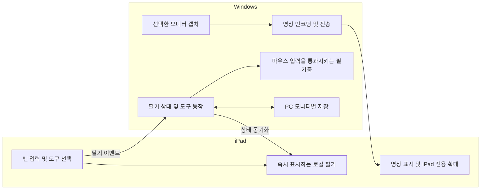

# 구조와 개발 순서

2026-10-16 사용자의 “뭐야 계속 진행”을 제시된 작업 순서, 테스트 범위, 초기 기준 커밋 비교 방식에 대한 진행 승인으로 반영했습니다. 동일 확인을 반복하지 않습니다.

## 단계 상태

| 단계 | 상태 | 결과 또는 다음 조건 |
|---|---|---|
| 1. 질문과 기획 | 완료 | requirements.md에 사용자 답변 반영 |
| 2. 설계·테스트 범위 | 완료 | 작업 순서와 verification-plan.md의 검증 범위 승인 |
| 3. 작업 분할·TDD 구현 | 진행 중 | 승인된 범위에서 한 테스트 → 최소 구현 순서로 진행 |
| 4. 오류·보안·성능 진단 | 대기 | 동작하는 대상과 재현 가능한 검증 절차 필요 |
| 5. 코드 개선·최종 검토 | 대기 | 실제 구현 변경과 테스트 결과를 기준으로 수행 |

## 재사용 후보

EternalMonitor의 MIT 소스를 Windows 화면 캡처, GPU 인코딩, USB 전송 및 iPad 영상 렌더링의 후보로 검토합니다. 기존 원격 입력 주입을 그대로 제품의 필기 기능으로 사용하지 않습니다. 사용자는 마우스로 PC를 조작하므로 별도의 필기 상태와 Windows 필기층이 필요합니다.

현재 확인한 후보는 Rust Windows 호스트와 Swift iPad 앱입니다. 후보의 특정 커밋, 실제 확장 지점 및 라이선스 근거는 [조사 문서](research/streaming-foundation.md)에 기록합니다. 기존 저장소의 동작 주장을 우리 제품에서 측정한 결과로 취급하지 않습니다.

후보 조사 기준은 `9888f37a5a457c76ec1d960dc9d9f1115304e6a9`입니다. Windows 호스트는 Rust 1.98.0, iPad 프로젝트는 iPadOS 17 이상을 기준으로 합니다. 재사용하는 소스의 MIT 고지는 유지하고 FFmpeg 등 외부 배포물의 조건은 따로 기록합니다.

## 구조

### 화면 구성

- Windows: 작업표시줄에서 상태 확인, PC 이름과 연결 상태, 모니터 선택. 발표 화면에는 필기와 포인터가 표시됩니다.
- iPad: 전체 화면 캔버스와 작은 도구막대. 자주 쓰는 펜·지우개·레이저를 바로 선택합니다.
- 손가락 제스처는 iPad 화면의 확대·이동에 사용합니다. 일반 터치 필기 모드는 제스처 충돌을 구분합니다.
- 도구 색상과 배치는 되돌릴 수 있는 기본값으로 시작하고 실사용 결과로 조정합니다.

### 상태의 기준

- 연결된 Windows PC가 해당 PC 필기 상태의 기준입니다.
- iPad는 로컬에서 먼저 표시한 입력을 식별자로 관리해 재전송·확인 응답이 중복 필기를 만들지 않게 합니다.
- 저장 키는 PC의 로컬 식별자와 모니터 식별자를 포함합니다. IP 주소만으로 PC를 구분하지 않습니다.
- 레이저와 사라지는 펜은 일시 상태입니다. 영구 필기와 구분하고, 만료된 표시를 재연결 후 복원하지 않습니다.
- 화면 크기나 배율이 바뀌면 새로운 좌표 조건을 적용합니다. 이전 조건으로 입력을 추정하여 잘못된 위치에 그리지 않습니다.

### 우선 해결할 기술적 불확실성

1. Windows 필기층은 Zoom에 보여야 하지만, iPad에서 로컬로 그린 필기가 영상에 포함되어 돌아오면 중복될 수 있습니다. 세션별 캡처 제외 지원과 대안을 실제로 검증합니다. 모든 캡처에서 창을 제외하는 설정을 무조건 적용하지 않습니다.
2. USB 연결이라는 이유만으로 지연이 작다고 간주하지 않습니다. 인코딩·큐·디코딩·화면 표시를 포함해 측정합니다.
3. 현재 Windows PC와 다른 PC의 OS/GPU 지원 범위가 같다고 가정하지 않습니다. 각 PC에서 기능 탐지와 최소 실행 검사를 합니다.
4. iPad 앱은 macOS/Xcode에서 빌드·서명하고 실기기에서 검사해야 합니다. Windows 측 테스트 통과만으로 iPad 검증 완료를 표시하지 않습니다.

Microsoft 공식 문서에서 `IDisplayGraphicsCaptureSession.SetWindowExclusionList`를 확인했습니다. 우리 WGC 캡처에서만 필기창을 제외하는 경로를 먼저 시험합니다. 현재 설치된 SDK보다 새로운 인터페이스이며, OS 빌드 번호만으로 실행 지원을 확정하지 않습니다. 지원하지 않는 PC에서 영상에 이미 들어간 형광펜·지우개를 확인 응답만으로 정확하게 분리할 수 있다고 가정하지 않습니다. 이 기능의 실제 지원과 대체 경로는 작업 01의 선행 기술 검증입니다.

## 개발할 작업 — 승인됨

각 작업은 사용자가 확인할 수 있는 동작 단위입니다. 아래 전체 순서와 테스트 범위를 승인받았으므로 작업별 로컬 티켓으로 관리합니다.

| 번호 | 작업 | 선행 작업 | 완료 결과 |
|---|---|---|---|
| 01 | 연결해서 화면 보고 선 하나 그리기 | 없음 | iPad에서 선택한 PC 모니터를 보고 입력한 선이 Windows에 표시되는 최소 경로. 캡처 중복과 초기 지연도 기록 |
| 02 | iPad만 확대해서 정확히 필기하기 | 01 | 확대·이동 후에도 PC 배율과 필기 위치가 정확하며 마우스 조작 유지 |
| 03 | 발표용 도구 사용하기 | 02 | 기본 도구, 색·굵기, 실행 취소·다시 실행, 지우기·숨기기, 지원 기기 더블탭 |
| 04 | PC 두 대 전환 및 필기 복원 | 03 | PC별 필기 분리, 끊김 후 복구, 앱 재시작 후 저장 내용 복원 |
| 05 | 발표 중 지연·안정성·입력 검증 | 04 | USB/유선 비교, Zoom 수신 화면 확인, 장시간 사용, 잘못된 입력·재연결·저장 실패 처리 확인 |
| 06 | 구조 개선과 설치 가능한 첫 버전 정리 | 05 | 중복·복잡성 검토, 회귀 테스트, Windows 실행물과 iPad 빌드·설치 안내. 실기기 검증 결과와 남은 제한 명시 |

01의 첫 테스트는 플랫폼 전체를 흉내 내는 테스트가 아니라 필기 이벤트를 실제 필기 상태로 적용하는 공개 동작부터 시작합니다. 이를 Windows 필기층과 iPad 입력 경로에 연결하고, 해당 작업 전체가 실제 화면에서 검증될 때 01을 완료합니다.

## 작업 관리

사용자가 선택한 로컬 작업 관리를 사용합니다. [로컬 티켓 규칙](agents/issue-tracker.md)에 따라 작업 하나당 파일 하나를 작성하고 선행 작업을 기록합니다. 아직 설치되지 않은 Kanban 도구를 설치되었다고 표시하지 않습니다.

최종 코드 검토 기준은 구현 전 초기 기준 커밋으로 제안합니다. 리뷰 때 실제 커밋을 기록하고 요구사항과 코딩 기준을 별도로 검사합니다.
